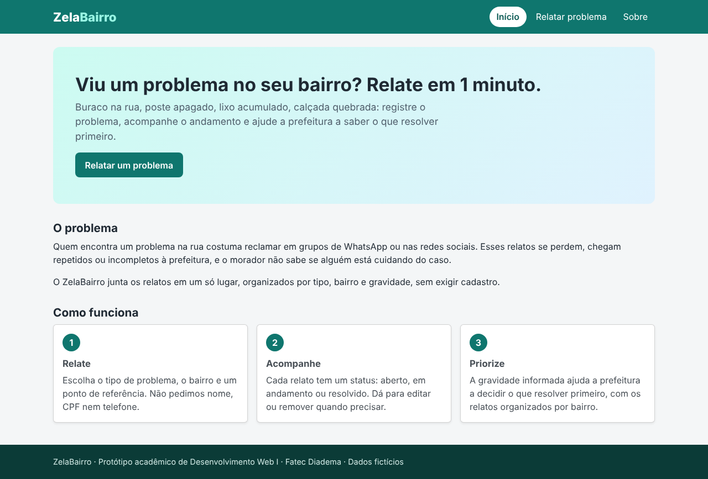
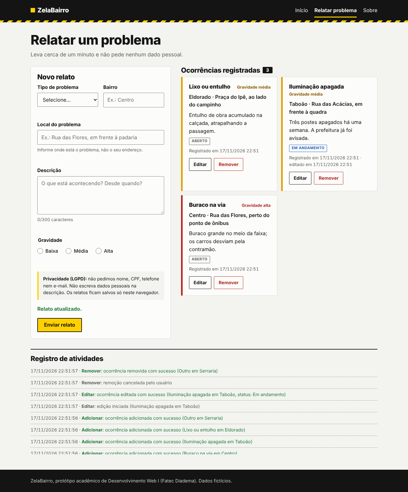
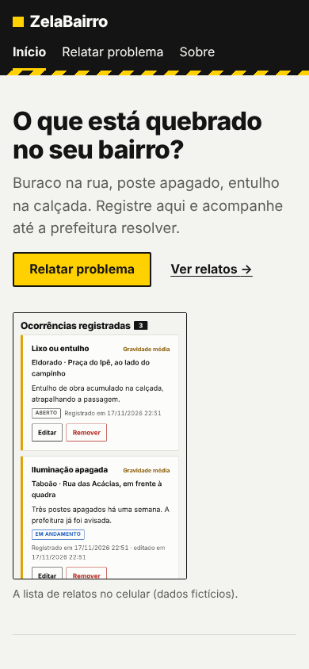
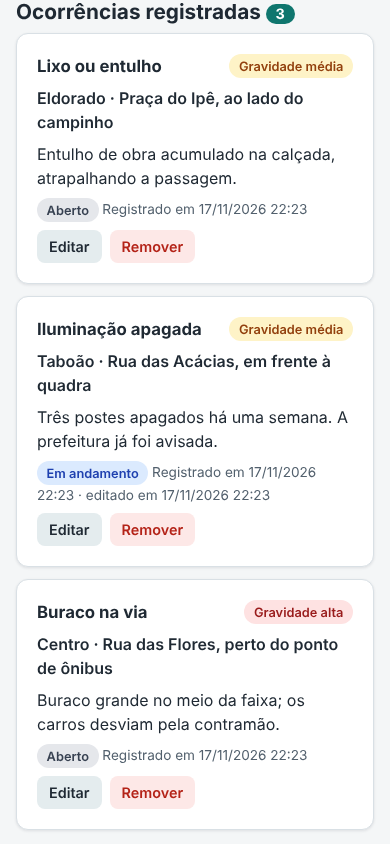
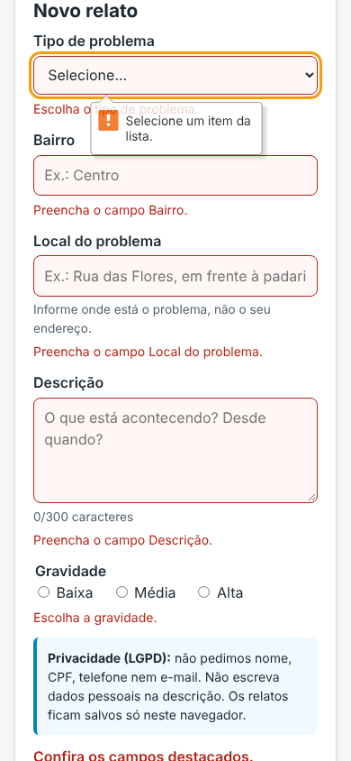
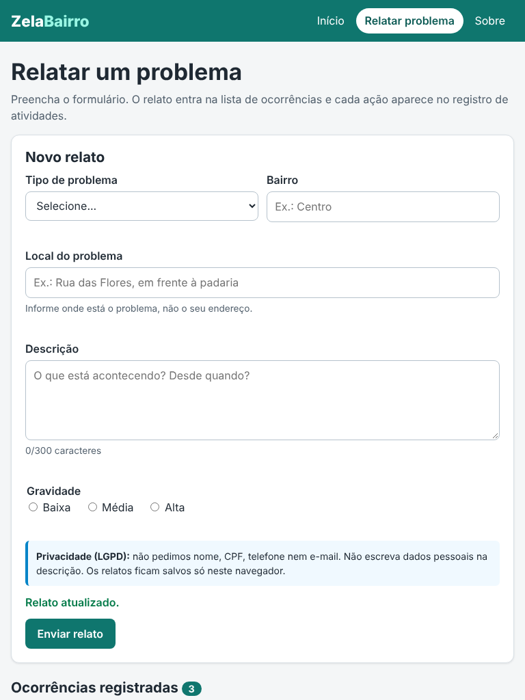
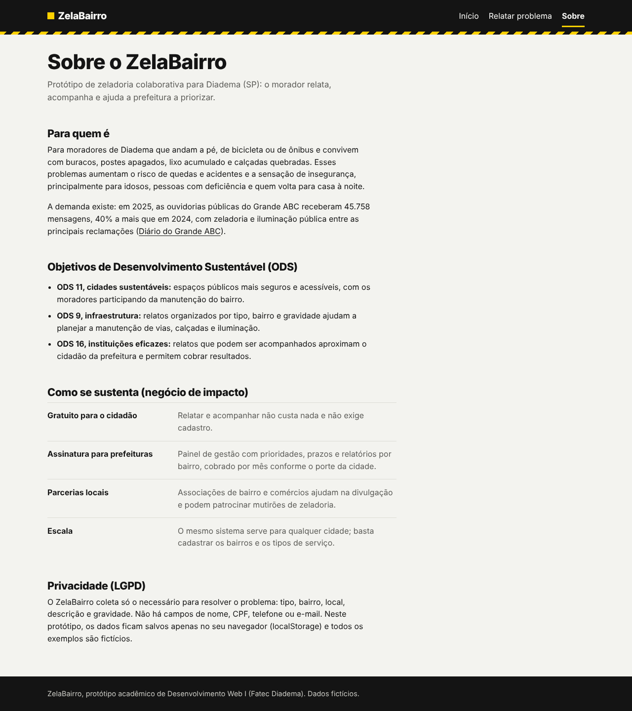

# ZelaBairro

**Site no ar:** https://notgabxx.github.io/zelabairro/

Site para relatar problemas de zeladoria do bairro (buraco na rua, poste apagado, lixo acumulado, calçada quebrada) e acompanhar a solução.

Protótipo da atividade **Tecnologia Cidadã** de Desenvolvimento Web I (Fatec Diadema).
Tema: *Serviços públicos e participação cidadã* (zeladoria colaborativa).
Autor: Gabriel Soares Costa

## Objetivo

Juntar em um só lugar os relatos de problemas de rua, organizados por tipo, bairro e gravidade e sem exigir cadastro, para o morador acompanhar o andamento e a prefeitura saber o que resolver primeiro.

## Problema e cidadão

**Cidadão:** morador de Diadema (SP) que anda a pé, de bicicleta ou de ônibus e convive com buracos, postes apagados e calçadas quebradas, principalmente idosos, pessoas com deficiência e quem volta para casa à noite.

**Problema:** as reclamações se espalham por grupos de WhatsApp e redes sociais, chegam incompletas ou repetidas à prefeitura e o morador não sabe se alguém está cuidando do caso. Em 2025, as ouvidorias do Grande ABC receberam 45.758 mensagens (40% a mais que em 2024), com zeladoria e iluminação entre as principais reclamações ([Diário do Grande ABC](https://www.dgabc.com.br/Noticia/4284094/procura-por-ouvidorias-publicas-registra-alta-de-40-em-um-ano-no-grande-abc)).

**ODS:** 11 (cidades sustentáveis), 9 (infraestrutura) e 16 (instituições eficazes).

## Funcionalidades

- 3 páginas com HTML semântico e menu de navegação: Início, Relatar problema e Sobre
- Formulário com `label`, validação nativa do HTML5 (`required`, `minlength`, `maxlength`, `pattern`) e validação em JavaScript com mensagem embaixo de cada campo
- Adicionar, listar, editar e remover ocorrências, atualizando a página pelo DOM
- Painel de registro de atividades com data/hora, ação e resultado de cada operação
- Dados salvos no navegador com `localStorage` (continuam lá ao recarregar a página)
- Layout responsivo Mobile First, testado em 390px (celular), 768px (tablet) e 1280px (desktop)

## Tecnologias

- HTML5 semântico
- CSS3 em arquivo externo: Flexbox, Grid e media queries
- JavaScript puro, em 3 arquivos separados por responsabilidade
- [Bootstrap 5.3.3](https://getbootstrap.com/) via CDN, só na seção "Como funciona" da página inicial (grid)
- Git e GitHub

## Como executar

Para usar online, é só abrir https://notgabxx.github.io/zelabairro/. Para rodar no computador:

1. Clone o repositório:
   ```bash
   git clone https://github.com/Notgabxx/zelabairro.git
   ```
2. Abra a pasta `zelabairro` no VS Code.
3. Clique com o botão direito em `index.html` e escolha **Open with Live Server** (extensão Live Server).

Também funciona abrindo o `index.html` direto no navegador. O Bootstrap vem da internet: sem conexão, só a seção "Como funciona" perde o alinhamento em colunas.

## Estrutura de pastas

```
zelabairro/
├── index.html          # Início: problema e "Como funciona" (Bootstrap)
├── relatar.html        # Formulário, lista de ocorrências e registro de atividades
├── sobre.html          # Cidadão, ODS, modelo de negócio e privacidade
├── css/
│   └── style.css       # Estilos próprios (Mobile First, Flexbox e Grid)
├── js/
│   ├── validacao.js    # Regras de validação: vazio, tamanho, formato e tipo
│   ├── registro.js     # Painel de registro de atividades
│   └── app.js          # localStorage, adicionar/listar/editar/remover, DOM e eventos
├── img/
│   ├── favicon.svg     # Ícone da aba
│   └── relatos-celular.png  # Print real da lista, usado na página inicial
└── docs/
    └── prints/         # Capturas de tela usadas neste README
```

## Modelo de dados

Cada ocorrência é um objeto guardado em JSON no `localStorage` (chave `zelabairro.ocorrencias`):

| Campo | Tipo | Regra |
|---|---|---|
| `id` | texto | gerado pelo sistema (`oc-...`) |
| `tipo` | texto | `buraco`, `iluminacao`, `lixo`, `calcada`, `arvore` ou `outro` |
| `bairro` | texto | 3 a 40 caracteres, só letras e espaços |
| `local` | texto | 5 a 100 caracteres |
| `descricao` | texto | 10 a 300 caracteres |
| `gravidade` | texto | `baixa`, `media` ou `alta` |
| `status` | texto | `aberto` (padrão), `andamento` ou `resolvido` |
| `criadoEm` | data ISO 8601 | preenchida ao adicionar |
| `atualizadoEm` | data ISO 8601 ou `null` | preenchida ao editar |

## Segurança e privacidade

- Toda entrada é validada antes de ser usada: campo vazio, tamanho, formato e tipo (lista de opções permitidas)
- O texto digitado entra na página com `textContent`, nunca com `innerHTML`: HTML ou script digitado aparece como texto (proteção contra XSS)
- Leitura e gravação no `localStorage` dentro de `try/catch`; itens corrompidos ou adulterados são descartados
- Mensagens de erro sem detalhes técnicos (ex.: "Não foi possível carregar os dados. Tente novamente."); o detalhe vai só para o console
- Coleta mínima de dados (LGPD): o formulário não pede nome, CPF, telefone nem e-mail e tem um aviso de privacidade
- Bootstrap carregado com SRI (`integrity`): se o arquivo for alterado na CDN, o navegador bloqueia
- Nenhuma senha, chave ou segredo no repositório

## Prints

**Início (desktop)**



**Relatar problema (desktop):** formulário, lista de ocorrências e registro de atividades



**Celular:** início, lista de ocorrências e mensagens de validação

<p>
  
  
  
</p>

**Tablet:** tipo e bairro lado a lado



**Sobre (desktop)**



## Créditos

- [Bootstrap 5.3.3](https://getbootstrap.com/) (licença MIT), carregado pela CDN jsDelivr.
- Todos os dados de exemplo são fictícios.
